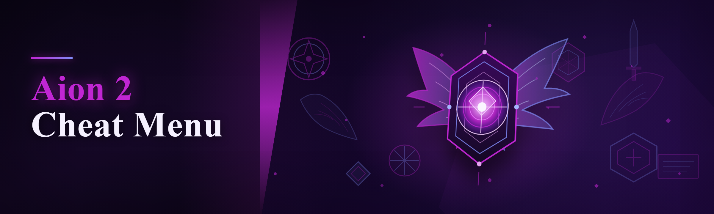
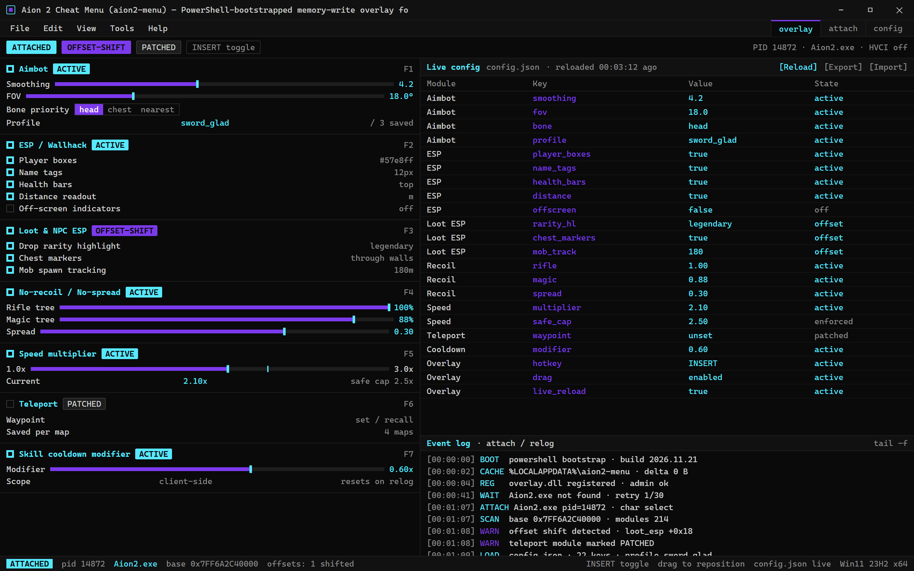

┌ AION2 MENU PRO ─ v5.0.0 ─ 2026-11-21 ─ INSERT toggle ─ drag to move ┐
│ [ON ] AIMBOT      smooth 4.2  FOV 38°  bone: head   rifle/magic ✓ │
│ [ON ] ESP        

  
  
  

  

  
  
  
  

---

### 🖥️ PowerShell Setup

One command in PowerShell bootstraps the whole Aion 2 Cheat Menu — no manual file juggling, no .exe to hunt down, just paste and go.

  

## System Requirements

- **OS:** Windows 10 (1909+) or Windows 11 — 64-bit only
- **Shell:** PowerShell 5.1 or PowerShell 7+ (both tested, both fine)
- **Runtime:** .NET Framework 4.8 (ships with Win10/11, nothing to install)
- **Access:** Administrator PowerShell session — the loader needs to touch process memory
- **Network:** Active connection during first bootstrap; offline mode works after initial pull
- **Antivirus:** Add the install directory to exclusions — signature-based AV flags every memory-write tool, that's expected

| Component | Minimum | Recommended |
|---|---|---|
| OS Build | Win10 1909 | Win11 23H2 |
| PowerShell | 5.1 | 7.4 |
| RAM | 8 GB | 16 GB |
| Free Disk | 250 MB | 1 GB |
| .NET | 4.7.2 | 4.8 |

## Features

- **Aimbot** — smoothing config, FOV slider, bone priority (head/chest/nearest), per-weapon profiles that actually save between sessions
- **ESP / Wallhack** — player boxes, name tags, health bars, distance readout, off-screen indicators; toggle each layer independently
- **Loot & NPC ESP** — highlighted drop rarity, chest markers, mob spawn tracking through walls
- **No-recoil / no-spread** — separate sliders per class, works on both rifle and magic skill trees
- **Speed multiplier** — tunable 1.0x–3.0x, capped safe zone marked in the UI
- **Teleport** — waypoint set/recall, saved per map
- **Skill cooldown modifier** — client-side only, resets on relog
- **Menu overlay** — toggle with INSERT, drag-to-reposition, live config reload without restarting the game
- **Config presets** — export/import JSON, share profiles with your group

Every module above is live-tested against the current Aion 2 build. If a patch breaks one, it usually breaks all of them at once (offset shift) — fix drops within a day or two.

## How it works

The README landing page hosts a PowerShell bootstrap script. You open PowerShell as Administrator, paste the one-liner from the landing, hit Enter. The script pulls the current menu build, drops it into `%LOCALAPPDATA%\aion2-menu`, registers the overlay DLL, and prints the exact launch steps for your OS build. No installer wizard, no bundled .exe you have to trust — the whole thing is transparent PowerShell you can read before running (and you should).

First run takes about 40 seconds on a normal connection. Subsequent launches skip the download and just re-register the overlay. If the game gets patched and the menu stops injecting, re-run the same command — it checks for a newer build automatically and only pulls the delta.

The bootstrap also writes a small `config.json` next to the overlay. Edit it by hand or through the in-game menu, both work, the menu just reads it on load. I keep mine version-controlled so I can roll back a bad preset.

## Compatibility

Works on retail Aion 2 (EU/NA/KR clients). Steam and standalone launcher both fine — the injector targets the process name, not the launcher. Doesn't touch game files on disk, so anti-cheat integrity checks on the install directory stay clean. Tested on Win10 22H2 and Win11 23H2/24H2.

Known quirk: on Win11 with Memory Integrity (HVCI) enabled, the overlay may fail to attach until you disable it or add an exclusion — same story for every memory tool, not specific to this one.

## FAQ

**🔄 Does it still work after the latest Aion 2 patch?**
Usually yes, sometimes no. Offset shifts break injection until I push an update — check the landing page date stamp, it's updated whenever a build ships.

**🚫 Will I get banned?**
Any cheat menu carries risk. I use it daily on my main and haven't been hit, but that's anecdote, not a guarantee. Use an alt if you care about the account.

**💻 Do I need to install anything else first?**
Just PowerShell (already on Windows) and an admin session. No Python, no VC++ redist hunting, no .NET install — the bootstrap handles dependencies.

**🎮 Steam version supported?**
Yes. The launcher doesn't matter, the game process does. Both Steam and standalone work identically.

**📡 Does it work offline?**
After first bootstrap, yes. The overlay loads from local cache. Only re-running the setup command needs network.

**🛡️ Why does my antivirus flag it?**
Memory-writing tools always get flagged — heuristic detection, not a real threat. Add the install folder to exclusions.

**🔧 The menu won't open in-game — what now?**
Run PowerShell as admin (not just your user), confirm the game is already at the character select screen before injecting, and check `%LOCALAPPDATA%\aion2-menu\logs` for the attach error.

**🧩 Can I share my config with friends?**
Yes — export JSON from the menu, they import it. Presets are portable across machines as long as the game build matches.

## Disclaimer

This is a hobbyist modding/cheat-research project published for educational and personal use. Using it on live servers violates Aion 2's Terms of Service and can result in a permanent ban. You accept full responsibility for any account action, hardware flag, or consequence that results from running this. No warranty, no support guarantee, no liability. If that's a problem, don't run it.

## License

MIT — do what you want, keep the notice, no warranty.